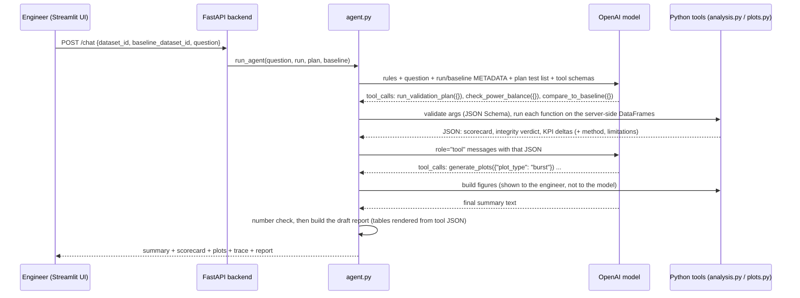

# PowerOps Agent: SST validation-report and regression agent

A local, tool-using AI agent that turns a bench validation run of a multi-port **solid-state transformer
(SST) feeding an 800 V DC bus** into a PASS/FAIL scorecard. It checks the run against a baseline revision for
regressions, verifies the power sensors can be trusted, and drafts a validation report for an engineer to
review and sign off.

> **Independent student prototype.** Not an official product of, or affiliated with, any company. It uses
> **synthetic data only**. The validation plan and acceptance criteria are **illustrative**, not product
> specifications. It never connects to hardware and never makes release, safety or certification decisions.
> It was motivated by public descriptions of multi-port SSTs for 800 V DC data-center power (for example,
> DG Matrix's announced *Interport* platform), but uses no company data, interfaces or specifications.

---

## 1. The process this automates

Every firmware or hardware revision of a power converter goes through the same validation sequence on the
bench. An engineer then spends hours turning the log into a report:

1. Find each test step in a long log.
2. Compute the KPIs: efficiency at each load point, bus deviation and recovery on load transients,
   ride-through behaviour, peak temperature.
3. Compare each KPI with the test plan's acceptance criteria.
4. Compare with the previous revision: *did anything get worse, even if it still passes?*
5. Sanity-check the measurements: *is a failing efficiency number real, or is a power sensor off?*
6. Write it all up with plots, methods and limitations.

PowerOps Agent does steps 1–6 in seconds and **stops at a draft**. The report ends with a blank sign-off
block, because the release decision belongs to engineers.

```
bench log (rev-B) ──┐
                    ├─► run_validation_plan ─► PASS/FAIL scorecard ─┐
validation plan ────┤                                               ├─► draft report ─► engineer review + sign-off
baseline (rev-A) ───┴─► compare_to_baseline ─► regressions ─────────┤
                        check_power_balance ─► sensor integrity ────┘
```

### The illustrative validation plan

[`config/validation_plan.example.json`](config/validation_plan.example.json). The log's `test_step` column
says which step is running, as a bench test sequencer would record it.

| Test | Step | What is measured | Illustrative acceptance |
|---|---|---|---|
| EFF-25/50/75/100 | 1–4 | Steady-state efficiency = energy out / energy in at 25/50/75/100% of rated load | ≥ 97.0 / 97.5 / 97.5 / 97.0 % |
| BURST-1 | 5 | 800 V bus deviation and recovery at every GPU-style load edge (±80 kW in 50 ms bursts) | \|deviation\| ≤ 16 V, recovery to ±4 V within 8 ms |
| SAG-1 | 6 | Grid sag to 0.5 pu: bus minimum and how fast the battery port picks up the grid deficit | bus ≥ 760 V, pickup ≤ 20 ms |
| THERM-1 | 7 | SiC module temperature during a full-load soak; end-of-soak slope (is it still rising?) | peak ≤ 125 °C, slope ≤ 1 °C/s |

The plan also defines **regression tolerances** (for example, efficiency may not drop by more than 0.2
points) and **power-sensor integrity checks**:
- The battery port must read about 0 kW while the grid is healthy.
- Implied efficiency must be physically plausible.

### What the demo shows

The **Load demo pair** button loads two synthetic runs of the same unit:

| | rev-A (baseline) | rev-B (candidate) |
|---|---|---|
| Scorecard | 7/7 PASS | 4/7 PASS: EFF-25, BURST-1, THERM-1 fail |
| Story built into the synthetic model | – | +0.7 kW fixed loss (efficiency down at light load and SiC 14 °C hotter), weaker bus control (bus dip doubles), slower battery pickup (still passes, but flagged as a regression) |

A follow-up run, `data/SYNTHETIC_SST_revC_candidate.csv` (or *rev-C* in the generator), fixes rev-B's bus control and most
of its extra loss but has a much slower battery-port response. It scores 6/7: SAG-1 fails (pickup 38 ms vs ≤ 20 ms),
BURST-1 is better than rev-A, and EFF-25 and THERM-1 still pass but are flagged as regressions against rev-A. Load it
against rev-A or rev-B as the baseline to see how the comparison changes.

A third run, `data/SYNTHETIC_SST_revA_sensorfault.csv` (or *Inject a battery power-sensor fault* in the UI),
fails every efficiency test. The integrity check reports **SUSPECT** (the battery port reads 3 kW at idle),
and the agent warns that the efficiency failures are probably a measurement problem, not the hardware.

---

## 2. Quick start (macOS)

You need Python 3.11 or newer. Check with `python3.11 --version`. If it is missing, install
[Homebrew](https://brew.sh) and then:

```bash
brew install python@3.11
```

Set up the project (run these from the `powerops-agent` folder):

```bash
python3.11 -m venv .venv
```

```bash
source .venv/bin/activate
```

```bash
pip install -r requirements.txt
```

```bash
cp .env.example .env
```

The `.env` file is optional. Leave `OPENAI_API_KEY` empty to use the no-API **demo mode**, or paste your key
to enable the LLM. Any OpenAI-compatible endpoint works: for Google Gemini, set
`OPENAI_BASE_URL=https://generativelanguage.googleapis.com/v1beta/openai/` and `OPENAI_MODEL=gemini-flash-latest`.

Start the backend in one Terminal window (keep it running):

```bash
source .venv/bin/activate && uvicorn api.main:app --reload --port 8000
```

Start the UI in a **second** Terminal window:

```bash
source .venv/bin/activate && streamlit run app/streamlit_app.py
```

Open <http://localhost:8501>. API docs are at <http://127.0.0.1:8000/docs>.

Run the tests (no API key or network needed):

```bash
source .venv/bin/activate && pytest
```

### Using the app

1. **1 · Load runs**: click **Load demo pair** (rev-A baseline + rev-B candidate). You can also generate a
   run, or upload a CSV, as either the *run under test* or the *baseline*.
2. **2 · Validate with the agent**: click **Generate the validation report for this run**, or ask something
   narrower: *"Does the 800 V bus recover fast enough from GPU load bursts?"*, *"Did the battery port pick up
   the load during the grid sag?"*, *"Can we trust the power-sensor data?"*
3. Each answer shows:
   - the agent **mode**
   - the scorecard and regressions
   - the **plots** (baseline overlaid in orange, dashed)
   - the **tool-call trace**
   - a **number check**
   - **Download draft report (.md)**

---

## 3. How the tool-calling flow works

The model never does the maths. It only decides **which** Python function to run and **with which
arguments**. Python does the measuring and hands back JSON.



Step by step (see `_run_llm` in [`powerops/agent.py`](powerops/agent.py)):

1. **Describe the tools.** `build_tool_schemas(plan)` in [`powerops/tools.py`](powerops/tools.py) lists six
   tools with JSON Schemas for their arguments. Test IDs come from the plan, so the model can only ask for
   tests that exist.
2. **Ask the model.** We send the system rules, the question, and metadata for the run and baseline
   (unit ID, revision, sample count, which test steps exist). The raw samples are **never** sent.
3. **The model asks for tools,** for example `run_validation_plan({"test_types": ["load_burst"]})`.
4. **We run them.** `run_tool()` validates the arguments and runs the Python function. The data, the plan
   and the acceptance criteria come from the server, never from the model. Bad JSON, unknown tools and
   invalid arguments come back as `{"error": ...}`, so the model can try again.
5. **Send results back** as `role: "tool"` messages linked by `tool_call_id`, and **repeat** until the model
   answers in text. There is a cap of 8 rounds; after that it is forced to answer with `tool_choice="none"`.
6. **Check and report.** Every number in the answer is checked against tool outputs, and the report is built.

| Tool | What it returns |
|---|---|
| `run_validation_plan` | PASS/FAIL scorecard; per-test KPIs vs illustrative acceptance criteria; per-test details (every burst edge, the sag event, the thermal soak) |
| `compare_to_baseline` | Same plan run on the baseline; per-KPI baseline → candidate deltas; regressions beyond tolerance; verdict changes |
| `check_power_balance` | Sensor integrity: battery-port idle offset, implied-efficiency plausibility windows → CONSISTENT/SUSPECT |
| `summarize_run` | Duration, sample rate, per-channel stats, which test steps exist, plan tests with no data |
| `detect_threshold_violations` | Every excursion beyond the illustrative channel limits |
| `generate_plots` | `overview`, `efficiency_curve`, `burst`, `grid_sag`, `thermal` (the model only gets a description) |

The building-block analyses (`evaluate_efficiency`, `analyze_load_bursts`, `analyze_grid_sag`,
`evaluate_thermal`) are separate, separately tested functions in [`powerops/analysis.py`](powerops/analysis.py).
`run_validation_plan` dispatches to them by test type, so adding a new test type means writing one function.

### Why the LLM cannot invent measurements

| Guard | Where |
|---|---|
| The model only sees tool outputs, never raw samples. A test proves a mid-run raw bus-voltage reading never appears in anything sent to the API. | `agent.py`, `tests/test_agent.py` |
| The system prompt forbids arithmetic or new measurements and requires copying numbers from tool results. | `SYSTEM_PROMPT` |
| Every number in the answer is matched against tool outputs, allowing for rounding. Unmatched numbers are flagged in red and listed in the report. | `numbers_check.py` |
| Every table in the report is rendered from tool JSON. Only the *Summary* is LLM text. | `report.py` |
| The model cannot pass data, change acceptance criteria, or name tests outside the plan: the schemas reject it. | `tools.py` |

### Demo mode, fallbacks and safety scope

- **Demo mode:** `plan_demo_tools()` picks tools with keyword rules, and `compose_demo_answer()` fills a
  template. It is deterministic, so the tests and offline demos use it.
- **Fallback:** if the API fails (bad key, no network, rate limit, timeout), the agent falls back to demo
  mode and says so.
- **Control requests are refused** before any tool runs, for example *"Flash the new firmware to the unit"*
  or *"Increase the current limit"*.
- **Release questions get the scorecard plus a notice.** For *"Is rev B ready to release?"*, the notice says
  release and sign-off decisions belong to qualified engineers.

---

## 4. Data format

CSV, one row per sample. Lines starting with `#` are comments; `# key: value` lines (for example
`# unit_id: SST-DEMO-001`, `# revision: rev-B`) become run metadata.

| column | unit | meaning |
|---|---|---|
| `timestamp_s` | s | time since start of run |
| `test_step` | – | integer step of the validation sequence (from the test sequencer) |
| `grid_voltage_pu` | pu | grid-port AC voltage, per-unit of nominal |
| `grid_power_kw` | kW | power drawn from the grid port |
| `battery_power_kw` | kW | battery port: + discharging into the DC bus, − charging |
| `rack_power_kw` | kW | power delivered to the 800 V DC rack/load port |
| `dc_bus_voltage_v` | V | 800 V DC bus voltage |
| `sic_temp_c` | °C | SiC power-module temperature |

Validation ([`powerops/data_io.py`](powerops/data_io.py)):

- **Errors (file rejected):** empty file, header only, missing columns, malformed rows, non-UTF-8 files,
  fewer than 2 valid timestamps, more than 2,000,000 rows.
- **Warnings (file accepted):** extra columns, non-numeric or infinite values, rows without a timestamp,
  unsorted or duplicate timestamps, missing or non-integer `test_step`, channels with no data. Plan tests
  whose step is missing are reported as **NOT RUN**.

`data/` contains the three synthetic runs; `data/bad_examples/` has broken files to try in the UI.

## 5. Synthetic data generator

[`powerops/synthetic.py`](powerops/synthetic.py) uses a deliberately simple model:

- **Losses:** `fixed + k·P²`, which gives an efficiency curve.
- **Grid power:** load + losses.
- **800 V bus:** droop plus a damped-sine kick at every load edge.
- **Grid sag:** the grid port supplies only 30% of demand, and the battery port ramps up after a delay.
  Power not yet supplied pulls the bus down.
- **SiC temperature:** a first-order lag on losses. The time constant is deliberately sped up so a 26 s
  demo shows thermal behaviour.

Revisions A and B differ only in their loss, bus-control and battery-response parameters. Every file starts
with a `# SYNTHETIC DATA ... NOT real measurements` banner.

```bash
python scripts/generate_synthetic.py --revision B --seed 43 --out data/my_revB.csv
```

```bash
python scripts/generate_synthetic.py --revision A --sensor-fault --out data/my_fault.csv
```

## 6. Adapting it to a real bench

- Replace the plan JSON with your own tests and acceptance criteria. Add a test type by writing one
  evaluator in `analysis.py` and registering it in `EVALUATORS` and `TEST_TYPES`.
- Map your logger's column names to the schema above, and make sure the sequencer writes `test_step`.
- Point `POWEROPS_PLAN_PATH` at your plan. Nothing else in the agent changes.

---

## 7. Project structure

```
powerops-agent/
├── api/main.py                  FastAPI backend (in-memory dataset store)
├── app/streamlit_app.py         Streamlit UI (talks to the backend over HTTP)
├── config/validation_plan.example.json   Illustrative plan, limits, tolerances
├── data/                        Synthetic rev-A / rev-B / sensor-fault runs + broken examples
├── powerops/
│   ├── data_io.py               CSV loading, schema validation, run metadata
│   ├── synthetic.py             Synthetic multi-port SST generator (revisions, sensor fault)
│   ├── config.py                Plan loader/validator
│   ├── analysis.py              Test evaluators + run_validation_plan + compare_to_baseline + integrity
│   ├── plots.py                 generate_plots (Plotly)
│   ├── tools.py                 Tool schemas (built from the plan) + validated dispatcher
│   ├── agent.py                 OpenAI tool-calling loop, demo planner, safety guard
│   ├── numbers_check.py         Flags numbers in the answer that no tool produced
│   └── report.py                Draft validation report with sign-off block
├── scripts/generate_synthetic.py
└── tests/                       pytest suite (108 tests)
```

| Method | Path | Purpose |
|---|---|---|
| GET | `/health`, `/plan` | Status / the current (illustrative) validation plan |
| POST | `/datasets/upload` | Upload a CSV → `dataset_id`, metadata, warnings, preview |
| POST | `/datasets/synthetic` | `{revision: A\|B, seed, battery_sensor_fault}` |
| POST | `/datasets/demo-pair` | rev-A baseline + rev-B candidate in one call |
| GET | `/datasets/{id}`, `/datasets/{id}/csv` | Info / download |
| GET | `/datasets/{id}/plots/{type}?test_id=&baseline_id=` | Plotly figure JSON |
| POST | `/chat` | `{dataset_id, baseline_dataset_id?, question, mode}` → summary, tool calls, figures, report |

## 8. Tests

`pytest` runs 108 tests in a few seconds, with no network access:

- **Analysis:** each evaluator is checked against hand-built signals with known answers. For example, a
  10 V dip decaying with a 2 ms time constant must recover in exactly 2 ms, and a 50 kW load with 1 kW of
  loss must read 98.039%.
- **Process tools:** rev-A passes 7/7; rev-B fails exactly EFF-25, BURST-1 and THERM-1; the regression check
  flags the slower battery pickup even though it still passes; the sensor fault is caught.
- **Agent:** classification and refusals, demo planner, determinism, and the OpenAI loop against a
  **scripted fake client**: tool calls, bad arguments, API errors with fallback, the round limit, and a
  fabricated number being flagged.
- **`test_api_e2e.py`, the end-to-end demo test:** upload rev-A and rev-B, ask for the validation report,
  then check the verdicts, regressions, plots and every report section.
- **`test_streamlit_app.py`:** drives the real UI (demo pair, then report), plus the backend-down case.

## 9. Limitations

- **The live OpenAI API is not called by the test suite.** The loop is tested against a fake client with the
  same response shape. Results with a real key depend on the model; choose one via `OPENAI_MODEL`.
- **One run per revision:** run-to-run variation is not measured, so small deltas may be noise. Tolerances
  exist for this reason.
- **The number check is a heuristic.** It catches invented numbers but cannot catch a real tool value quoted
  in the wrong place.
- **Simple measurement model:** single-sample time resolution and raw-sample peaks. The synthetic device
  model is educational, not a converter simulation.
- **Local use only:** in-memory datasets and no authentication.

## 10. Troubleshooting

- **"Cannot reach the backend":** start `uvicorn api.main:app --reload --port 8000` from the project folder.
- **`ModuleNotFoundError: powerops`:** run commands from the `powerops-agent` folder with the venv active.
- **"Fell back to the deterministic demo mode":** the notice shows the OpenAI error. Check the key, the model
  name and your network, and leave `OPENAI_TEMPERATURE` unset.
- **Port already in use:** use `--port 8001` and set `POWEROPS_API_URL=http://127.0.0.1:8001`.
